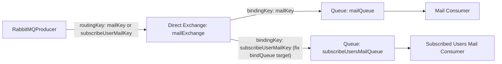

# RabbitMQProducer Overview

`RabbitMQProducer` publishes JSON-serialized mail payloads to a **direct** exchange (`queueExchange.mailExchange`) using `amqplib`-style channel operations.

## Methods

1. **`mailMessageProducer(data)`**
   - Asserts the direct exchange `queueExchange.mailExchange` and queue `queueNames.mailQueue`.
   - Binds `queueNames.mailQueue` to `queueExchange.mailExchange` using `queueRouting.mailKey`.
   - Publishes the stringified payload buffer and returns `true` if accepted into the write buffer, or `false` otherwise.

2. **`mailMessageToSubscribedUsersProducer(data)`**
   - Asserts `queueExchange.mailExchange` and queue `queueNames.subscribeUsersMailQueue`.
   - Publishes the payload with routing key `queueRouting.subscribeUserMailKey`.

# RabbitMQ Routing Flow

- **Producer** sends a JSON payload to the **direct exchange** with a **routing key** (`mailKey` or `subscribeUserMailKey`).
- **Exchange** matches the message's **routing key** against each queue's **binding key** and routes it to the matching **queue**.
- **Consumer** pulls and processes messages from its subscribed **queue**.
- **Code check:** In `mailMessageToSubscribedUsersProducer`, `bindQueue` currently binds `queueNames.mailQueue` instead of `queueNames.subscribeUsersMailQueue` — update that target queue so `subscribeUserMailKey` routes to the right queue.

## Playlist Reference

https://www.youtube.com/playlist?list=PLZVBmpM0E_DHlA9Fz4QznfPjUKPIz48I7
